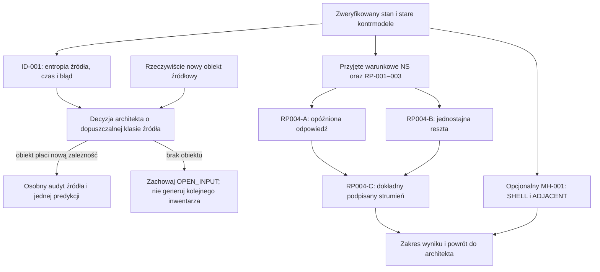

# FIN — strategia badań po audycie stanu i źródła dynamiki

Data: 2026-10-19. Status: **ARCHITEKTURA BADAŃ; ZADANIA NIEWYKONANE**.
Uwzględnia dodatkowe polecenie dotyczące wyłaniania dynamiki z wewnętrznych
korelacji nadsolitonu. Nie zmienia `AGENTS.md` ani praw FIN.

## 1. Decyzja strategiczna

**Obecna matematyka FIN nie wymusza jednej własnej ewolucji.** Pozwala budować
i badać różne ewolucje po dostarczeniu danych dynamicznych. To stwierdzenie
wynika z konkretnych kontrmodeli, nie wyłącznie z braku odnalezionego pliku.
Nie jest twierdzeniem, że żadne przyszłe rozszerzenie FIN nie może wyprowadzić
dynamiki z bogatszego, jawnie zdefiniowanego obiektu informacyjnego.

Najgłębszym wspólnym problemem jest **brak niezależnie uzasadnionej mapy od
wewnętrznych danych FIN do typu stanu, prawa zmiany i sprzężeń**. Nie jest to
tylko swoboda jednostki czasu. Przy tej samej równowadze, symetriach, a nawet
tym samym punktowym dryfie, istnieją różne aktywności i fluktuacje. W rodzinie
polowej ten sam kernel i Hessian dopuszczają różne nieliniowości.

Dlatego następne zadanie o najwyższej wartości fundamentalnej to
[ID-001](research_tasks/01_ID001_ENTROPY_SOURCE_BOUND.md): **ilościowy test
możliwości uzyskania rodzimej kinetyki skokowej z deterministycznego nośnika
o skończonej entropii dynamicznej**. Ogólny zakaz dokładnej realizacji
ciągłoczasowego procesu Markowa przez taki nośnik jest znany w literaturze;
nie należy go odkrywać ponownie. Nowy cel lokalny to powiązanie istniejącego
procesu N2 FIN, starej nierówności Fano ST383, rozdzielczości czasu i błędu
odtwarzania w jeden precyzyjny kontrakt źródłowy.

To test ograniczonej klasy kandydatów, nie nowy postulat o tym, że sam
nadsoliton koniecznie jest skończenie wymiarowy lub ma skończoną entropię KS.
Wynik negatywny również będzie wartościowy. Zadanie nie wyprowadzi samo
nowego generatora, fizycznego zegara ani QM.

## 2. Co jest rzeczywiście dostępne

| Warstwa | Mocny aktualny wynik | Nadal nie wynika |
|---|---|---|
| Kernel i skończona statyka | Operacyjny kernel, A7; R7O3 Target P i MP7 pierwsza koegzystencja w określonych rodzinach | Konieczność naturalnego A7, wszystkie punkty stacjonarne X7, pełna fizyka |
| Rodzimy model q12 | TH/SF/UF/MT: działanie trajektorii, zatrzymane i krytyczne granice, lokalny reżim | Źródło samplera, fizyczny czas, globalne Gamma=B4 |
| Obserwacje | OBS–SRN i NT: kontrolowane klasyczne prawa, kontrasty, transfer | Aparatura, niezgodne instrumenty kwantowe, Born, fizyczna energia |
| Aktywność | RC: afiniczna relacja szybkości; AC: rekonstrukcja z pełnej punktowej kowariancji skoków | Źródło tej kowariancji; średnia stacjonarna nie wystarcza |
| Odporność kinetyczna | KR pod NC/IBA; BA dokładna kompresja parzystości; RB/SC/PC/DH częściowe redukcje przepływu | Bezwarunkowe IBA, pełny Hall, globalny skonstruowany generator diagnostyczny |
| Wspólne działanie polowe | UE: jawne źródła i nieliniowe kontrmodele; NS: pełna warunkowa stabilność orbitalna i lokalny transfer | Ścisłe pochodzenie parametrów, geometria, asymptotyczna stabilność, cząstki 3D |
| RP | Mod związany, normalizacja kontinuum, Gamma>125/73728 w zamrożonej rodzinie | Dodatni dokładny strumień rozwiązania nieliniowego; zależność aktywnego przykładu od kernela |

Statusy oparto na treści dowodów, kontraktów, kodu i późniejszych korektach.
Obecny audyt nie przelicza wszystkich dawnych certyfikatów. Zakres odczytu,
przeszukiwania i kontroli integralności zapisano w `fin_strategy_audit_20261019/`.

## 3. Wybór priorytetów

Oceny poniżej są porównaniem strategicznym, nie oszacowanymi statystycznie
prawdopodobieństwami sukcesu. S oznacza krótki dowód/małą kontrolę; M —
ograniczone badanie analityczne, bez wielkiej enumeracji.

| Priorytet | Kierunek | Wartość fundamentalna / rozstrzygalność / koszt | Decyzja |
|---|---|---|---|
| P0 | ID-001: źródło o skończonej entropii a rodzime prawo skokowe | Wysoka jako falsyfikator klasy źródeł; dobra wykonalność przy precyzyjnej metryce; S/M | **Uruchomić jako pierwszy pakiet**, potem wrócić do architekta |
| Warunek wejścia | Nowy niezależny obiekt określający aktywność lub nieliniowe współczynniki | Najwyższa, ale brak rzeczywistego nowego wejścia | Bez pustej kampanii; przyjęcie dopiero po otrzymaniu konkretnego obiektu |
| P1 | RP004-A/B/C: opóźniona odpowiedź → błąd → podpisany strumień | Znacząca matematyka wspólnego działania, ograniczona wartość dla pochodzenia FIN; M | Gotowa osobna kontynuacja istniejącego RP-004 |
| P2, opcjonalny | MH-001: jeden rosnący zbiór we włóknach Halla | Nowa treść techniczna dla q12, mała bezpośrednia wartość źródłowa; M | Tylko zamrożone SHELL/ADJACENT; bez dalszych skończonych dziur |
| Odroczony | Naprawa arytmetyki B4 i pełny replay | Ważna dla globalnego metastabilnego wykładnika; większy koszt | Wznowić tylko przy celu wymagającym globalnego B4; obecny program go nie potrzebuje |
| Wstrzymany | Źródło jednostek, selektora, ogólny bridge legacy→strict | Fundamentalne, lecz wyczerpane obecne klasy | Wymagany nowy obiekt lub zmieniony, jawny zakres przesłanek |
| Zależny od danych | Empiryczny test / fizyczny interfejs | Kluczowy dla testowalności | Brak samodzielnej aktywacji bez kalibracji, źródła danych i uprawnień |

Dodatkowy cel użytkownika ustawia ID-001 przed łatwiejszą kontynuacją
warunkowej fizyki polowej. Nie unieważnia aktualnego wskazania RP-004 jako
następnego **wewnętrznego zadania tej gałęzi**. Źródło dynamiki i konsekwencje
już zadanego działania pozostają osobnymi pytaniami.

## 4. Adaptacyjna architektura

Nie ma strzałki „dodatni strumień → naturalny generator” ani „Hall →
czasoprzestrzeń”. Zależności te wymagałyby własnych twierdzeń.

## 5. Najważniejsze rozstrzygnięcia historii

1. `fin_coupled_evolution_source_review_20261017/NEXT_OPEN_ATOM.md` proponował
   stabilność; NS ją później opłacił warunkowo. Nie uruchamiać NS ponownie.
2. Starsze NOT_EXECUTED dla RP zastąpił aktualny intake z 19 października:
   RP-001–003 wykonano; RP-004 jest otwarte. Powtórzenie Gamma nie jest nową pracą.
3. Ogólny brak danych wejściowych w post-MM został zawężony przez RC/AC:
   istnieją konkretne obiekty matematyczne i inverse kowariancji. Nadal brak
   niezależnego źródła aktywności, nie brak wszystkich możliwych zadań.
4. SC obaliło silniejszą drogę shielding-weight na rzeczywistych cięciach.
   Nie wolno jej przywracać pod nową nazwą ani uznać za obalenie pełnego Halla.
5. Target P ma późniejsze globalne domknięcie; stary GLOBAL-OPEN nie jest
   bieżącym zadaniem. Globalne B4 to inne twierdzenie i pozostaje nieprzyjęte.
6. W QW-206 kod histogramuje odstępy widmowe, choć `paper.tex` używa tego jako
   dowodu entropii KS i strzałki czasu. Ten krok inferencyjny nie jest opłacony.
   Nie zmieniono oryginalnych plików; ustalenie ma osobny zapis audytowy.

Szczegóły: [mapa poprzedników](FIN_PRIOR_RESEARCH_MAP.md),
[blokady](FIN_BLOCKERS_REGISTER.md),
[ocena źródła ewolucji](fin_strategy_audit_20261019/INTRINSIC_EVOLUTION_ASSESSMENT.md).

## 6. Warunki sukcesu i zatrzymania

Sukcesem jest poprawny dowód w zamrożonym zakresie, rzeczywisty kontrprzykład
albo dokładnie wskazana nieopłacona nierówność. Nie jest nim liczba PASS,
nowy katalog, lepsza cyfra ani zamiana źródła na dopasowany model.

Każdy pakiet kończy się po jednej zadeklarowanej metodzie i najwyżej jednej
naprawie wynikającej z konkretnego wykrytego błędu. Zmiana nośnika, zegara,
obserwacji, kernela, potencjału lub parametrów celu wymaga powrotu do
architekta. Negatywne wyniki zachować. Nie zmieniać fizycznego modelu w celu
uratowania przewidywania.

Nie uruchamiać automatycznie eksperymentów, nowych źródeł danych, kampanii
kwantowej/grawitacyjnej ani zatrzymanej ciężkiej algebry. Zachować ontologię
nadsolitonu jako pierwotnej informacji w stanie solitonicznym, rozdział
legacy/strict, QW-2191, transfer ról oraz istniejące bramki jednostek i EV.

## 7. Uruchomienie

Gotowe instrukcje są w [research_tasks/README.md](research_tasks/README.md).
Domyślny start: **wyłącznie ID-001**. Kolejność, równoległość i punkty
powrotu opisuje [plan wykonania](FIN_RESEARCH_EXECUTION_PLAN.md).
Ta strategia nie wykonała żadnego z zaplanowanych pakietów.
