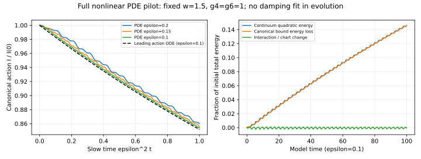

# CM audit completed; full nonlinear PDE pilot started

Date: 2026-11-07. Parent e2c8a788252d3cedc21fd8f1939d59e00cb8350e.

The critical CM audit found no substantive error. AW is retained as a
conditional theorem requiring independent review. The default chain of
same-author audits is now stopped. Work has moved to direct nonlinear
PDE computations and a specific FIN-to-action matching problem.

## Full model computation

Nine runs evolve both nonlinear perturbation fields and both physical
velocities. The implementation uses fourth-order centered finite differences
and explicit fourth-order Runge-Kutta. It evolves the full RP forces,
including quadratic, cubic and quintic terms. It does not evolve the
averaged action ODE or fit damping into the field equation.

This is an independently formulated numerical route relative to the
normal-form approximation, implemented by the same agent. It is not an
independent-team replication. Canonical observables are reconstructed
from physical modal projections by numerically undoing the exact CM
auxiliary flows. The continuum remains part of the field evolution.

The declared pilot parameters are w=1.5, g4=g6=1, epsilon=0.2,0.15,0.1
and T=epsilon^-2. The coefficients are a fixed example, not inferred
physical constants. Periodic computational boundaries lie at L>=T+30;
the analytic kink is retained in the perturbation equation. No damping
layer, incoming drive or radiation subtraction is applied.

The leading coefficient predicted by CD is k_a=0.2836716043. To obtain
a diagnostic from each PDE trajectory, a straight line is fitted to
1/I(t) over the predeclared last three quarters of the interval. Its
slope is a finite-window effective coefficient, not an exact measurement
of the asymptotic constant or a fit used in the solver.

| epsilon | dx | dt (approximately) | Effective k_a | Difference from predicted k_a |
| --- | --- | --- | --- | --- |
| 0.20 | 0.10 | 0.020 | 0.280486989 | -1.123% |
| 0.15 | 0.10 | 0.020 | 0.281114093 | -0.902% |
| 0.10 | 0.10 | 0.020 | 0.282713455 | -0.338% |
| 0.10 | 0.05 | 0.010 | 0.282699678 | -0.343% |

The largest action discrepancy divided by epsilon^2, on the dx=0.1
runs, decreases from 0.00816 to 0.00459 to 0.00203. Three amplitudes at
one parameter value do not establish an asymptotic error exponent.
The remaining discrepancy exceeds the observed numerical refinement
changes and includes finite-amplitude effects and switch-on history.

## Energy transfer and numerical controls

Every run shows positive growth of quadratic continuum energy. At
epsilon=0.1 on the finest mesh, canonical bound energy falls by
0.00109418165 and continuum quadratic energy rises by 0.00109820248.
The interaction/chart energy changes by -0.00000402085; it is retained
in the balance, not mistaken for an energy leak or silently discarded.
The total-energy definition uses the symmetric discrete Laplacian of
the evolved semidiscrete Hamiltonian. Continuum-energy diagnostics are
therefore numerical observables whose continuum limit needs convergence.

At epsilon=0.1:

- Halving dt at fixed dx changes the fitted slope by 3.84e-9.
- Enlarging L from 130 to 170 changes it by 2.61e-15.
- Halving dx at the same dt=0.01 changes it by 1.38e-5.
- Relative total-energy drift on the finest run is 2.73e-9.

All six declared numerical quality controls passed. The finite-box checks
are evidence against contamination in this pilot, not a theorem about
boundary errors. Separate spectral/finite-volume replication and explicit
outgoing-flux balance remain future numerical checks.

CM has 50 integrity/algebra/flow checks; the bridge has eight exact checks.
These counts are kept separate from the nine PDE runs and their six quality
controls. None substitutes for independent proof review.

## What is and is not supported

The pilot supports the predicted dominant energy-transfer mechanism and
the leading k_a in one fixed parameter case. It does not test k_b and
k_x separately: the current preparation makes the second action too small,
and w=1.5 is the special zero canonical shape-slip case. It does not
establish the whole parameter band, all-time behavior or empirical FIN.

The first bridge result is explicit: changing g4,g6 leaves the entire
linearized kink operators unchanged but changes the nonlinear field
forces. Spectral matching alone cannot identify the full action. See
FIN_BRIDGE_START.md for the exact witness and matching targets.

Next execute the parameter/threshold and amplitude campaign described
in NEXT_RESEARCH.md. Continue the strict-core nonlinear matching task in
parallel as a distinct derivation problem. Further self-audits require a
new concrete discrepancy or an actual new theorem.
