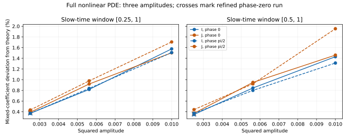

# Third-amplitude mixed-damping study with joint refinement

## Results

Three new full nonlinear PDE runs at epsilon=0.05 reach T=400, or slow time
tau=epsilon^2 t=1. Two phases use dx=0.1, dt=0.02; a phase-zero control
uses dx=0.05, dt=0.01. The supplied PDE and theoretical coefficients remain
unchanged. This is a numerical study, not a strict-FIN derivation.

The reference mixed coefficient is kx=0.258892167626. Below are all primary
fits on tau in [0.25,1], including the previous two-amplitude campaign:

| epsilon | psi phase (rad) | dx | kx from I | kx from J | I deviation | J deviation |
|---|---|---|---|---|---|---|---|
| 0.1 | 0.000000 | 0.1 | 0.2629731243 | 0.2627854226 | 1.5763% | 1.5038% |
| 0.1 | 1.570796 | 0.1 | 0.2627943184 | 0.2633094301 | 1.5072% | 1.7062% |
| 0.075 | 0.000000 | 0.1 | 0.2610087569 | 0.2612718734 | 0.8176% | 0.9192% |
| 0.075 | 1.570796 | 0.1 | 0.2610574778 | 0.2614233594 | 0.8364% | 0.9777% |
| 0.05 | 0.000000 | 0.1 | 0.2598498067 | 0.2599018938 | 0.3699% | 0.3900% |
| 0.05 | 0.000000 | 0.05 | 0.2598498021 | 0.2599010763 | 0.3699% | 0.3897% |
| 0.05 | 1.570796 | 0.1 | 0.2598531372 | 0.2600136192 | 0.3712% | 0.4332% |

comparison.json also retains tau in [0.5,1], separate integration/sampling
controls, and all exploratory extrapolations. Raw CSV files contain 4001
canonical-action observations per new run.

The primary discrepancy decreases again, to about 0.37-0.43%, for both
phases and both actions. The phase-zero refined run retains this trend.
It is not explained by the tested mesh/time-step sensitivity. This supports
a finite-amplitude correction but does not certify its order or zero limit.

## Numerical controls

The maximum change in an inferred coefficient under simultaneous halving
of dx and dt, across both windows and action estimates, is 8.5949349e-07
(0.000332% of theory). Maximum coarse/fine trace differences relative
to their initial canonical actions are [3.076925228388651e-08, 3.553664623509154e-07].
This control applies to phase zero. It does not establish separate spatial
and temporal convergence orders or a rigorous solver-error bound.

Across the new runs, maximum relative global-energy drift is 1.6259667e-06
and maximum local-energy-plus-integrated-outward-flux residual is
4.4768539e-07, normalized by initial total perturbation energy. Flux is
computed at radii 10 and 20 from the physical current at RK4 stages, not
inferred from energy loss. Metadata retains these maxima, not full spatial
fields or energy histories.

Changing integration spacing from approximately 0.1 to 1.0 at fixed
regression nodes changes kx by at most 1.7217667e-07
(0.000067% of theory). With dense integration fixed, changing
regression-node spacing changes kx by at most 4.6479255e-05
(0.017953% of theory). These deterministic sensitivities
are not statistical error bars. The diagnostic interval itself is not halved.

## Model and preparation

The unmodified previous campaign solver supplies Fourier collocation and
RK4 for the two-field model, w=1.5, g4=g6=1, K=tanh(x),
f=sqrt(3/4)sech^2(x), g=sqrt(3/2)sech(x)tanh(x). Initial data are
eta=epsilon g, eta_t=0, psi=epsilon cos(theta) f,
psi_t=-sqrt(w)epsilon sin(theta) f, theta=0 or pi/2.
The periodic domain is [-430,430); it grows with T to retain the previous
propagation margin. No explicit dealiasing is used. Shared canonical maps
and integrator prevent describing this as independent-team replication.

Physical quadratic initial actions match between phases, but nonlinear
canonical initial actions may differ. Their actual values enter the
estimator. Self-channel coefficients ka and kb remain fixed at theory;
regressions have a free intercept. Consequently self-channel corrections
can contaminate the inferred kx. The historical AW preparation is different.

## Extrapolation sensitivity, not a limit theorem

For each phase, action and time window, fit kx(epsilon)=b+c epsilon^p to
three coarse-grid amplitudes, separately assuming p=1 and p=2. The range
of inferred intercept deviations from theory across those eight fits is:

| Assumed leading correction | Minimum intercept deviation | Maximum intercept deviation |
|---|---|---|
| epsilon^1 | -1.16642% | -0.58599% |
| epsilon^2 | -0.12812% | 0.07153% |

Neither correction power has been derived. Three amplitudes cannot select
an asymptotic law reliably. The intercept depends on that choice and on
finite-window oscillations; there is no certified nonzero or zero residual
in the epsilon-to-zero limit. No confidence interval is asserted.

## Claim boundary and next step

Status: THIRD_AMPLITUDE_AND_JOINT_REFINEMENT_COMPLETED;
MIXED_ASYMPTOTIC_LIMIT_OPEN. Numerical trends do not extend AW to these
auxiliary mixed preparations. AW remains conditional, with independent
review outstanding. No natural action, physical clock, photons, SI units,
SM/GR, empirical FIN confirmation or ToE closure follows.

This completes the requested bounded third-amplitude check. Do not default
to another long sequence of same-author audits or amplitude scans. The
next priority is the already identified FIN bridge: examine one concrete
strict-core nonlinear compression/evolution candidate and its state map,
and test whether it actually exports the fourth/sixth-order response data
needed to constrain g4/g6. Treat any added kinetic, locality, history or clock
premise explicitly as an additional assumption. Use the existing spectral
non-identifiability witness rather than repeating a generic source inventory.
If no such candidate licenses the derivatives, record that specific missing
premise instead of claiming a derivation. A future numerical revisit should
be tied to a new higher-order action prediction or a specific new discrepancy.
